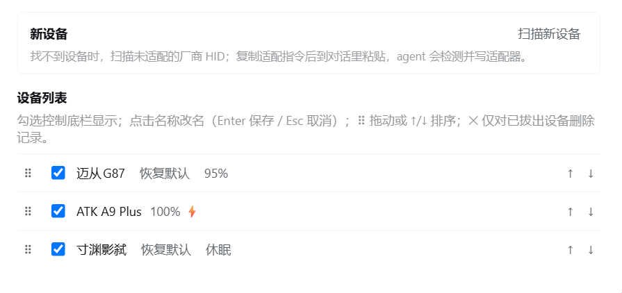
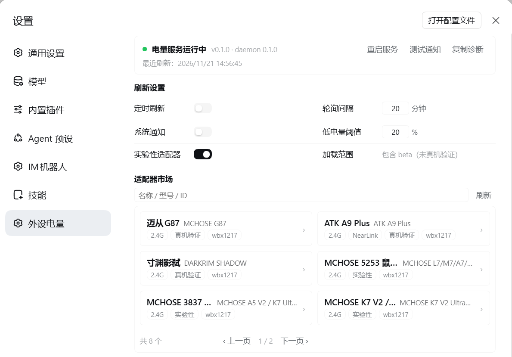

# 无线外设电量

在 DeepSeek Harness 里查看本机 2.4G 无线外设的电量：对话里问一句就有答案，底栏瞄一眼就有数；开启低电量提醒后，快没电时 Windows 会弹系统通知。

## 界面预览

<table>
  <tr>
    <td></td>
    <td></td>
  </tr>
  <tr>
    <td></td>
    <td></td>
  </tr>
</table>

截图来自真实 DSH 页面。截图/GIF 制作规范见 [docs/SCREENSHOTS.md](docs/SCREENSHOTS.md)。

## 它能做什么

- **agent 工具**：`battery_status` 读电量、`battery_devices` 管理设备（显隐/改名/排序/移除）、`battery_ble` 扫蓝牙设备、`battery_market` 搜索/安装社区适配器、`battery_detect` 发现新设备、`battery_protocols` 查已知协议、`battery_exchange` / `battery_listen` 直接试探/抓包、`battery_save_adapter` 写入适配器、`battery_probe` 看本机 HID 集合、`battery_adapters` 管理适配器、`battery_config` 读写设置。
- **状态栏**：显示自定义名、休眠/已拔出占位；设备多时折叠为前 3 台 + `+N`；无设备时显示「未发现无线外设 · 去设置」；标题可点击直达设置页，旁边是图标刷新按钮（刷新完成前禁用）。
- **设备管理页**：设置 → 外设电量，包含服务状态、首次引导、定时刷新/间隔/阈值/通知设置（修改即时生效），以及设备显隐、改名、拖拽/↑↓ 排序、已拔出设备移除、新设备扫描。
- **插拔即刷新**：daemon 监听 `WM_DEVICECHANGE`，HID 设备到达/移除后立即刷新；底栏通过长轮询接收快照变化，没有固定间隔轮询。
- **适配器市场**：设置页内置搜索/预览/安装面板（分页 + 5 分钟缓存 + 结构化详情弹窗），默认索引在 GitHub Pages 不可达时依次回退到 Gitee / jsDelivr / raw；「新设备」扫描后会按 VID/PID 自动匹配市场条目；也支持 agent 的 `battery_market` 工具。
- **定时刷新默认关闭**：只在你手动开启后才按设定间隔后台查询；平时用底栏刷新图标或设备插拔事件更新。
- **系统通知**：电量跌落阈值且设备在放电时，发一条 Windows Toast（走 DSH 已注册的 AUMID，不需要额外安装任何东西）；需要同时开启低电量提醒与后台定时刷新，首次引导会帮你选择。
- **区分设备状态**：`online`（读到电量）/ `asleep`（省电休眠）/ `unplugged`（已拔出，保留上次读数）/ `error`（在但读失败）。休眠不误报成 0%，读取失败不伪装成休眠。

## 架构

三层边界，新增驱动前先看 [docs/ARCHITECTURE.md](docs/ARCHITECTURE.md)：

- **Rust 做“能力”**：HID 枚举/读写、BLE、XInput、标准 HID Battery Usage，以及以后的串口/RFCOMM；
- **JS 做“协议”**：厂商电量帧、匹配规则、解析细节，支持热加载；Factory 分 `stable`（真机验证）和 `beta`（未验证，默认加载、可在设置关闭）；
- **市场做“长尾”**：分发社区适配器，未验证/分型号协议优先放这里，默认不抢占首屏。

新增 JS 适配器见 [docs/ADAPTERS.md](docs/ADAPTERS.md)：

```powershell
node scripts/new-adapter.mjs my-device "My Device"
npm run check:adapters
```

Factory 适配器放 `adapters/`；个人/实验性适配器放 `%LOCALAPPDATA%\dsh-peripheral-battery\adapters`。

## 安装

发布包支持两种形态：**目录**（插件市场的解压目录）和 **`.tgz`**（npm pack 产物）。

### 目录安装

1. 拿到发布包（插件市场目录或 zip 解压后的目录）；
2. 在 DSH 的 **Plugins → Add plugin** 里选择该目录，或让 agent 用 `plugin_manager` 的 `install_bundle` 指向目录绝对路径；
3. 安装后重启/刷新页面即可。

### `.tgz` 安装

```text
tar -xzf dsh-peripheral-battery-0.1.0.tgz
```

解压后进入 `package/`，把 **这个目录** 作为插件目录安装，不要直接选 `.tgz` 文件。目录里应能看到 `package.json`、`index.js`、`client.js`、`bin/`。

侧车 exe 随包提供：`bin/peripheral-battery-daemon.exe`（常驻查询）和 `bin/peripheral-battery-cli.exe`（HID 枚举/抓包调试）。只有改了 Rust 源码才需要运行 `./scripts/build.ps1` 重新构建。

插件启动时会检查：

- 只在 **Windows** 上加载；
- 缺少 `bin/*.exe` 时直接报“请重新安装完整发布包”，不会进入半坏状态。

## 首次使用

安装后第一次打开会自动进入“首次使用”引导：

- 列出已检测到的无线外设；
- 选择是否开启**低电量提醒**（会同时开启后台定时刷新）；
- 不开启则明确说明只在手动刷新时检查；
- 没有设备时提供「扫描新设备」入口。

设置页始终可以重新配置，首次引导完成后不再出现；完成前设置页会保留引导卡片。底栏没有设备时会显示「未发现无线外设 · 去设置」，不会一直停在加载中。

## 使用

对话里直接问：

- 「我键盘还有多少电？」
- 「耳机是不是快没电了？」
- 「为什么我的新鼠标不支持？」

设置也可以让 agent 改：`battery_config`，或打开 **设置 → 外设电量**。

截图/GIF 制作流程见 [docs/SCREENSHOTS.md](docs/SCREENSHOTS.md)。

## 没有对应设备怎么办

先看 **设置 → 外设电量 → 复制诊断**，它会把问题定位到数据源，而不是只给一个空列表。

### 一台设备都没有

1. 确认 Windows 能识别接收器/设备（设备管理器、厂商软件）；
2. 2.4G 设备先插好接收器、按一下设备唤醒；
3. 关掉可能独占 HID 通道的厂商软件（G HUB、Synapse、厂商 HUB）再刷新；
4. 确认 `betaEnabled` 没关（关闭后只会加载 3 个 stable 适配器）；
5. 蓝牙设备需要已配对且在附近；Fast Pair 耳机需要广播电量；
6. Phone Link 需要安装、连接手机，并生成 `StartMenuCompanion.json` 卡片。

### 有设备，但没有对应型号

1. 设置 → 适配器市场，搜索型号或 ID；
2. 新设备扫描会按 VID/PID 自动匹配市场条目；
3. 有匹配时先 **预览源码**，确认后安装；
4. 没有匹配时，在对话里说“帮我适配这个新设备”，agent 会走 `battery_detect → battery_protocols → battery_exchange/listen → battery_save_adapter`；
5. 适配失败时，把 `battery_probe`、原始应答和诊断信息发到 issue，不要只发“读不到”。

### 有适配器但读取失败

- 设备可能休眠：按一下设备再查；
- 厂商软件占用了 HID：关闭后再查；
- 同一接收器有多个 HID 集合：用 `battery_probe` 确认集合，再让 agent 校正适配器；
- `asleep` 是正常省电，`error` 才是故障。

## 当前支持的设备

| 设备 | VID:PID | 协议 | 来源 |
|---|---|---|---|
| 迈从 MCHOSE G87（2.4G） | `41E4:2001` | 20 字节帧 / `SET_REPORT` / 命令 `0x4A` | 出厂适配器（[adapters/mchose-g87.js](adapters/mchose-g87.js)） |
| MCHOSE L7/M7/A7/K7、A5 V2、G3 V2、K87 V3 | `5253` / `3837:100C` 等 | 0x12 Feature / 0x4D 设备信息 / G3 查询 / K87 键盘 | 市场适配器（experimental，**未在本机验证**，需从市场安装） |
| DARKRIM SHADOW 耳机（2.4G，杰理方案） | `3654:6901` | 65 字节 RCSP / interrupt OUT / TLV + CRC16 | 出厂适配器（[adapters/darkrim.js](adapters/darkrim.js)） |
| ATK A9 Plus NearLink 鼠标 | `373B:1115` | 17 字节 / Report ID `0x08` / 命令 `0x04` / 帧和 ≡ `0x55` | 出厂适配器（[adapters/atk-a9-plus.js](adapters/atk-a9-plus.js)） |
| ATK A9 Air / VXE R1 / IMECOO P1（Compx 17B 族） | `373B:1278` / `373B:10C9` / `3554:FB34` | 17 字节 / `0x08` / `0x04` / 载荷和 ≡ `0x4D` | 出厂适配器（[adapters/compx-17b.js](adapters/compx-17b.js)，协议来自 Voltide，**未在本机验证**） |
| MCHOSE K99 v2 / Z75S（20B 族） | `3554:FA09` / `258A:01BB` | 20 字节 / `0x13` / `0x4A` / 和校验 | 出厂适配器（[adapters/mchose-20b.js](adapters/mchose-20b.js)，协议来自 Voltide，**未在本机验证**） |
| 蓝牙设备（BLE 耳机/键鼠/触控笔等） | — | GATT Battery Service `0x180F`/`0x2A19`；读不到再看 Windows 蓝牙栈已知电量（会校验 ConnectionStatus） | Rust daemon 内置 BLE 通道 |
| Phone Link 手机 | — | 读取 Phone Link 的 `StartMenuCompanion.json`（本地文件，只读） | Rust daemon（**未在本机找到 Phone Link 卡片验证**） |
| Xbox 兼容手柄 | — | XInput 四档电量（full/medium/low/empty） | daemon XInput 源（有线 = 100% 充电中） |
| Logitech G304 / GPW3 / M750M / Unifying | `046D` | HID++ 2.0：槽位扫描 + feature 0x1000 / 0x1004 | 出厂适配器（[adapters/logitech-hidpp.js](adapters/logitech-hidpp.js)，实验性，**未在本机验证**） |
| 标准 HID Battery Usage | — | `0x06:0x20` / `0x85:0x65` | Rust daemon 通用兜底（**未在本机找到对应设备验证**） |

协议来源包括 [Voltide](https://github.com/sdparklab/Voltide)（MIT）、[BatteryHub](https://github.com/krisgfx9/Wireless-Device-Battery-Monitor)（GPLv3，仅参考协议事实，不复制实现）、厂商文档和字节级抓包；本插件用 JS/Rust 重写。ATK A9 Plus 的帧格式还参考 Linux 主线 `hid-kysona` 驱动和 LKML 描述符，并在本机实测通过（回复 `08 04 ... 64 01 10 46 ... 8C` → 100%、充电中、4166 mV）。

蓝牙扫描在 Rust daemon 内完成：先用 WinRT 读 GATT Battery Service，再读 Windows 蓝牙栈已知的电量属性；Fast Pair 耳机还会读 `0xFE2C` 广播里的左右耳/充电盒电量，设置页设备行会显示 `L/R/盒` 组件标签。读属性前会用 `BluetoothDevice.ConnectionStatus` 过滤掉关机后残留的节点。一次扫描约 1–3 秒，结果缓存 10 分钟，手动刷新超过 30 秒会重新扫描。**本机没有 BLE 外设，GATT 路径只验证了空设备；经典蓝牙（小度音箱）已验证「开机上报 / 关机变已拔出」。**

### 更多协议族（实验性，协议来自 Voltide，均未在本机验证）

| 设备 | 匹配 | 协议 |
|---|---|---|
| RAPOO VT3S | `24AE:1411` | 输入上报 report `0x07`；`byte[8]` 电量、`byte[7]` 状态 |
| 西伯利亚 XIBERIA T7 / T7 GT | `36F9:F008` | 64B：`55 65 00` → `reply[3]` 电量 |
| CROCIRIS X7 Receiver 8K | `36F9:AA20` | 65B：`00 AA 12` → `reply[5]` 充电、`[6]` 电量 |
| MCHOSE V9 Turbo+ 耳机 | `3837:600A` | 64B：`55 65 01` → `reply[2]` 电量、`[3]` 状态 |
| Sony PS5 DualSense / Edge | `054C:0CE6` / `0DF2` | 输入上报 `0x01`/`0x31`；status 低半字节 ×10% |
| DAREU A950 AIR V2 | `260D:1175` | 17B Compx 变体；校验 `sum<0x55 ? 0x85-sum : 0x155-sum` |
| 前行者 EWEADN S9 Pro | `372E:103D` | 64B Feature：`03 20 50 00 00 4F 81` |
| MCHOSE A7 Ultra | `5253`（FF01 / 65B Feature） | bond `0x03` + ost `0x06`，payload[9] 电量、[10] 充电 |

这些适配器只在对应设备在场时才会尝试读数；失败会落到「读取失败/休眠」，不会影响已验证设备。协议目录里还有 EWEADN A5 Pro、ATK N9 V2、MCHOSE K7/A5、ROG 等 `needs-capture` 条目，等真实设备接入后由 agent 抓包补齐。

## 设置

| 项 | 默认 | 说明 |
|---|---|---|
| `scheduled` | 关 | 是否启用定时刷新。默认关闭；开启后按间隔后台查询并提醒，关闭时只靠手动刷新与设备事件。 |
| `marketUrl` | 官方社区索引 | 社区适配器索引 URL；配置后 agent 可用 `battery_market` 搜索/安装。格式见 [docs/MARKET.md](docs/MARKET.md)。 |
| `intervalMinutes` | 30 | 后台轮询间隔（分钟，1–1440）。`battery_status` 默认读缓存，`refresh: true` 强制刷新。 |
| `thresholdPercent` | 20 | 低电量阈值（%）。只在「跨越阈值」时提醒一次，充电或回到阈值 +5% 以上后重新武装。 |
| `notify` | 开 | 是否发 Windows 系统通知。 |
| `betaEnabled` | 开 | 是否加载 `beta` 出厂适配器；关闭后只保留 `stable`（真机验证）适配器。 |

设置存在 `%LOCALAPPDATA%\dsh-peripheral-battery\settings.json`，所以改设置不需要重启 DSH。

开启「低电量提醒」时建议同时开启定时刷新；否则只有手动刷新或设备插拔时才会检查，设置页会直接提示并提供「开启后台检查」。

## 服务状态与诊断

设置页顶部常驻服务状态：

- **运行中/未启动、插件版本、daemon 版本、最近刷新、最后错误**；
- **重启服务**：重启 Rust 侧车并立即刷新；
- **测试通知**：发一条 Windows Toast，验证通知权限；
- **复制诊断**：复制插件/daemon 版本、设备、适配器、错误和路径，以及数据源状态（XInput、通用 HID、BLE/Fast Pair、Phone Link），便于反馈问题。

## 设备管理

设备元数据（显示名、可见性、顺序）存在 `%LOCALAPPDATA%\dsh-peripheral-battery\devices.json`，读数不落盘：

- 首次成功读到一台设备会自动加入列表；
- 拔出的设备保留「已拔出」占位，并显示上次读数（仅本次 DSH 运行期间）；
- 设置 → 外设电量 或 `battery_devices` 工具可以显隐、改名（恢复默认）、拖拽/↑↓ 排序、移除；
- 在线设备的「移除」等价于隐藏，已拔出设备才会删除记录；
- 「新设备 → 扫描新设备」列出未适配的厂商 HID；点「复制适配指令」后到对话里粘贴，agent 会继续抓包写适配器。

## 适配器：出厂 vs 用户

- **出厂适配器**：在插件包内的 `adapters/`，随插件更新，直接从包内加载，不复制到用户目录；
  - `stable`：本机/可信测试者真机验证；
  - `beta`：上游验证或有测试向量、本插件未真机验证，默认加载，可在设置页关闭；
- **用户适配器**：放在 `%LOCALAPPDATA%\dsh-peripheral-battery\adapters\`，插件更新永远不会覆盖或删除；
- 两者按 id 去重；用户文件名不能与出厂文件名相同，id 冲突时保留出厂适配器并报错；
- 旧版本曾把出厂适配器复制到用户目录；升级时这些旧副本会自动移到 `adapters-legacy-backup/`，不再参与加载。

新设备不用改插件源码：在用户目录放一个 `.js` 文件，调用
`defineAdapter({ id, name, kind, match, read(io) })`。`read` 通过 `io.exchange()`、`io.listen()` 或会话式 `io.withSession()` 直接发 HID 报文。

模板和 API 见 [docs/ADAPTERS.md](docs/ADAPTERS.md) 与 [templates/adapter-template.js](templates/adapter-template.js)。改完先校验：

```powershell
npm run check:adapters -- --user
```

再在对话里说「重新加载适配器」，agent 调用 `battery_adapters({ action: "reload" })` 即可生效。

## 社区适配器市场

市场仓库：

- GitHub：[wbx1217/dsh-peripheral-battery-adapters](https://github.com/wbx1217/dsh-peripheral-battery-adapters)
- Gitee 镜像：[yfrm/dsh-peripheral-battery-adapters](https://gitee.com/yfrm/dsh-peripheral-battery-adapters)

索引：

- GitHub Pages：`https://wbx1217.github.io/dsh-peripheral-battery-adapters/index.json`
- Gitee raw：`https://gitee.com/yfrm/dsh-peripheral-battery-adapters/raw/main/index.json`

验证报告入口：[adapter-verification.yml](https://github.com/wbx1217/dsh-peripheral-battery-adapters/issues/new?template=adapter-verification.yml)

出厂适配器覆盖不到的新设备，可以通过社区索引分发：

- **设置 → 外设电量 → 适配器市场**：搜索设备、查看源码、确认安装/移除；
- 已安装的市场适配器可在详情里「复制验证报告」，提交到市场仓库的 verification issue，用于 experimental → community → verified 晋级；
- 也支持 agent 用 `battery_market` 搜索/预览/安装；
- 安装会校验 SHA-256 与源码 id/match，写入用户适配器目录并热加载，不会覆盖出厂适配器。

索引格式、托管和 PR 审核流程见 [docs/MARKET.md](docs/MARKET.md)。设备覆盖矩阵（对照 BatteryHub）见 [docs/COVERAGE.md](docs/COVERAGE.md)。

国内镜像（插件默认索引失败时也会自动回退）：

```
https://gitee.com/yfrm/dsh-peripheral-battery-adapters/raw/main/index.json
```

## 添加新设备（不需要知道 VID/PID）

普通用户不需要查任何 ID。可以直接在对话里说：

> “我新买了一个 XXX 鼠标，帮我加进电量插件。”

也可以打开 **设置 → 外设电量 → 新设备 → 扫描新设备**，点「复制适配指令」后粘贴到对话里。

流程是：

1. agent 会请你把接收器插上、把设备打开，然后调用 `battery_detect({ mode: "watch", seconds: 20 })`；
2. watch 会对比前后两次枚举，**只报窗口期内新出现的设备**，并带上产品名（系统内置设备会被过滤掉）；
3. 你确认「是这台」之后，agent 再用它的集合试探协议、写适配器、热加载；
4. 之后问「XXX 还有多少电」就能读到。

如果设备已经插着，agent 用 `battery_detect({ mode: "list" })` 列出当前未适配设备，按产品名认领即可。
`battery_detect` 只负责“认设备”，VID/PID 是它输出给 agent 的内部信息，不需要用户提供。

一个真实可用的适配器：[adapters/atk-a9-plus.js](adapters/atk-a9-plus.js)（ATK A9 Plus 星闪鼠标）。

- 适配器运行在 `node:vm` 沙箱里，只能使用沙箱内创建的 `defineAdapter` 和空 `console`；`io` 是 JSON 桥，不是宿主对象。
- 没有 `require`/`fs`/`net`/定时器；这是软隔离，不是 OS 级安全边界，适配器仍需要你信任。
- 逆向新设备的流程：`battery_probe` 看集合 → `probe listen` 抓报文 → `probe exchange` 试探 → 写适配器。

## 协议目录：一句话适配

插件内置 [protocols/catalog.js](protocols/catalog.js)，把已知协议做成可检索的数据（帧格式、解析规则、验证状态、来源），而不是硬编码在代码里。

用户说“帮我适配这个新设备”时，agent 的闭环是：

1. `battery_detect` 认出设备（不需要用户报 VID/PID）；
2. `battery_protocols` 匹配已知协议——命中 `verified` / `experimental` 就直接拿到帧格式，并告诉你是否已有适配器；
3. 已有适配器：直接 `battery_status` 验证（大多数匹配设备到这里就结束了）；
4. 没有适配器但目录有协议：agent 按目录生成 `defineAdapter(...)`，`battery_save_adapter` 写入并热加载；
5. 目录也没命中：`battery_listen`（输入上报型）或 `battery_exchange`（查询型）直接抓原始帧，边试边写适配器；
6. 最后 `battery_status` 现场验证；不对就按 `probe exchange` 的原始应答校正。

`battery_status` 在检测到“未适配但协议目录有线索”的设备时，会直接在结果里给出提示，用户看到后说一句“帮我适配”即可。

目录当前收录：Compx 17B、MCHOSE 20B、Logitech HID++（实验性）、Razer 91B（实验性，需 write-only 原语）、ROG 64B、PS5（待抓包）。
没有命中时，agent 会退回到 `probe listen` / `probe exchange` 从头抓包，写完新协议再补进目录。

## 实现结构

```
index.js          Host：daemon 客户端、设备注册表、缓存、阈值检测、tools、HTTP 路由
client.js         Client：shell.bottom 摘要 + 内联设置 + 设置页设备管理
daemon-client.js  Host 侧 daemon 客户端（spawn/请求关联/超时/重启）
bin/              peripheral-battery-daemon.exe（常驻查询）+ peripheral-battery-cli.exe（HID 调试）
rust/             Rust 源码：HID 访问、Rust WinRT BLE、XInput、JSON-lines RPC
adapters/         出厂协议适配器（包内加载，随插件更新；用户适配器在 LOCALAPPDATA）
protocols/        已知协议目录（帧格式/解析/验证状态）
scripts/toast.ps1 Windows Toast（PowerShell 5.1 + WinRT）
```

一次刷新：daemon 枚举 HID → 适配器逐个读（会话式）→ Rust BLE 扫描 → 合并注册表。daemon 只在页面有长轮询订阅或收到刷新请求时运行；页面关闭后无请求，空闲 15 分钟退出。查询默认读缓存，`refresh: true` 或手动刷新才重新轮询。

## 已知限制

- 除本机验证过的 ATK A9 Plus、MCHOSE G87、DARKRIM SHADOW 外，其余协议族适配器（Compx 扩展、MCHOSE 20B 变体、Logitech HID++、RAPOO、DualSense、MCHOSE V9、西伯利亚 T7、CROCIRIS X7、DAREU）的协议来自 Voltide（MIT）的真机抓包，但**没有在本机对应型号上验证**；读不到时把 `battery_probe` 和 `probe exchange` 的原始应答发我，按真机校正。
- Xbox 手柄的 XInput 源只给四档电量，映射成 5/20/50/100%，不是精确百分比；本机当前没有手柄，只验证了空槽位路径。
- BLE 通道：Windows 已知电量路径已用本机蓝牙音箱实测（开机 60%，关机后变「已拔出」）；GATT Battery Service 主动读取仍未实测。
- 设备休眠时读不到电量（正常省电行为），按一下设备即可。
- 系统通知借用 DeepSeek Harness 的 AUMID，所以通知归属显示为 DeepSeek Harness，点击不会把 DSH 拉到前台。
- Windows 专属。

## 借鉴与致谢

这一版的部分协议和设计来自 [Voltide](https://github.com/sdparklab/Voltide)（MIT，Copyright (c) 2026 Joko）：

- **Compx 17 字节协议**：ATK A9 Air / VXE R1 / IMECOO P1 与 ATK A9 Plus 同族，校验规则一致（载荷和 ≡ `0x4D`）。
- **MCHOSE 20 字节协议的其它 PID**：K99 v2（`3554:FA09`）、Z75S（`258A:01BB`）。
- **XInput 四档电量映射**：full/medium/low/empty → 100/50/20/5；有线手柄视为 100% 充电中。
- **架构启发**：`Discover(catalog)` / `Read(device)` 分层、每次刷新只枚举一次 catalog、用 `BatteryMath` 把百分比归到档位。

近期新增的 DualSense、RAPOO VT3S、XIBERIA T7、CROCIRIS X7、DAREU A950、EWEADN S9 Pro、MCHOSE A7 Ultra / V9 协议也按同样方式收录进协议目录和适配器（同样标注未本机验证）。其中 RAPOO 与 DualSense 是“输入上报型”，插件给适配器补了 `io.listen()` 只读监听原语。

详见 [docs/THIRD_PARTY_NOTICES.md](docs/THIRD_PARTY_NOTICES.md)。带 `未在本机验证` 标记的协议是按 Voltide 的抓包移植的，真机差异请以你的设备数据为准。

## 许可与第三方

- 本项目采用 **MIT License**，见 [LICENSE](LICENSE)；`package.json` 的 `license` 字段为 `MIT`。
- 第三方声明见 [docs/THIRD_PARTY_NOTICES.md](docs/THIRD_PARTY_NOTICES.md)，包括 Voltide（MIT）和 BatteryHub（GPLv3，仅参考协议事实，不复制实现）。
- 如果未来复制任何 GPLv3 代码，整个衍生分发需要按 GPLv3 处理；当前策略是重写协议实现。
- 隐私：插件默认只读本机 HID/蓝牙/Phone Link 文件；网络访问仅用于拉取社区适配器索引和源码，不上传设备数据。

## DSH 官方市场状态

当前安装的 DSH `0.2.2-rc.5`：

- **Discover 只支持用户自定义插件索引**，没有可由第三方自行提交的官方索引；
- “官方 on-demand 插件”目录编译在 `@deepseek-ai/dsh-official-bundles` 里，随 DSH 发行版更新；
- 因此这个包已经按 bundle 要求准备好，但**不能仅靠本机操作直接上架官方目录**，需要 DSH 官方/发行渠道接收。

本包已具备的发布形态：

- `dsh.bundle.patch`、`dsh.client`、`dsh.bundle.platforms`；
- `locale/en.json`、`locale/zh.json` 的 `meta.title/description/detail`；
- 中英单图详情页 `docs/DETAIL*.md` + `docs/preview.svg`；
- `icon.svg`、MIT `LICENSE`、`engines.dsh`；
- `private` 已移除，`publishConfig.access = public`。

自托管/内测可以先走自定义索引；官方目录需要 DSH 团队把包名加入 `dsh-official-bundles` 的 on-demand 列表并随版本发布。

## 版本

- **0.1.0**：当前开发版；首次使用引导、服务状态/重启/诊断、新设备扫描与适配指引、底栏空状态与设备折叠、免构建发布包、Gitee 镜像回退。
- 后续：BLE 标准通道（GATT Battery Service / devnode 属性）继续补齐真机验证；市场按未支持设备自动推荐适配器。
